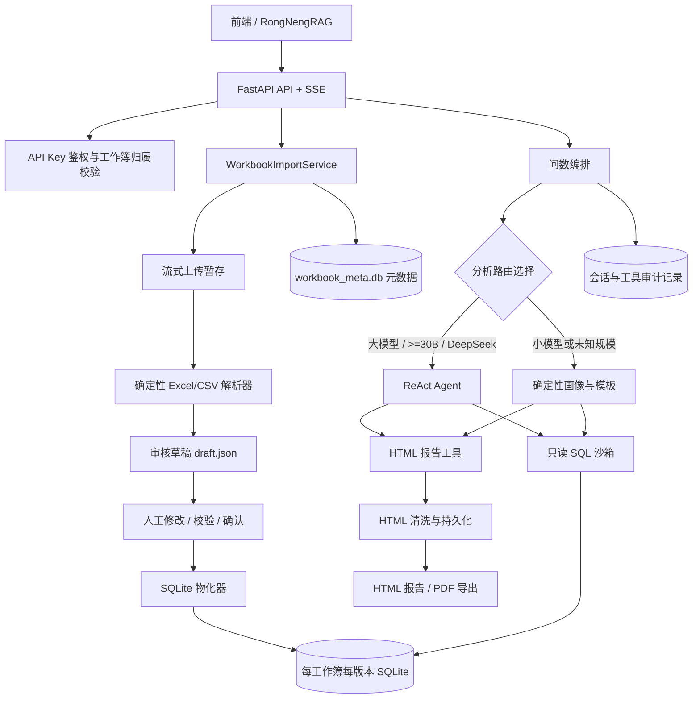
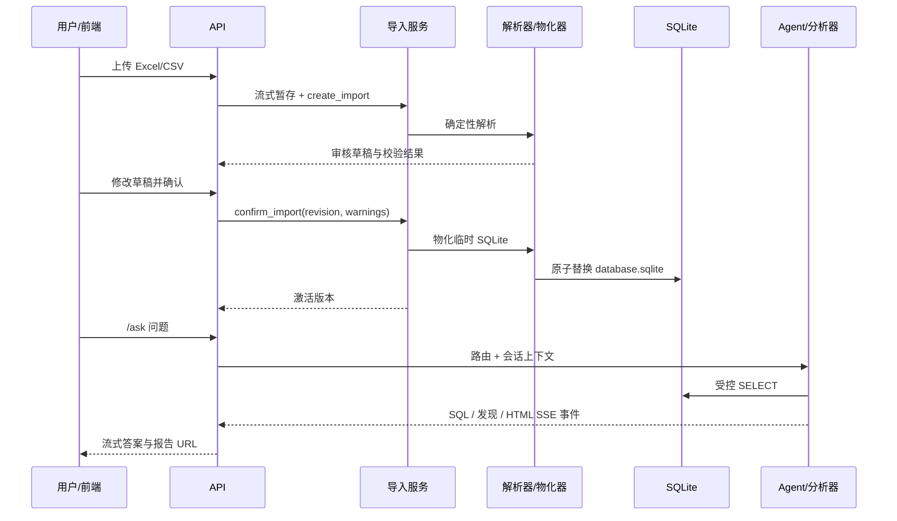

# Excel 智能问数项目：整体架构与核心机制

## 1. 项目定位

Excel Agent 是一个独立的 FastAPI 微服务，把半结构化的 Excel/CSV 工作簿转换为**可审核、可版本化、可只读查询的 SQLite 数据集**，并在此基础上提供自然语言问数和 HTML/PDF 分析报告。

核心链路是：

```text
Excel/CSV 上传
  → 确定性解析与审核草稿
  → 人工确认
  → 版本化 SQLite 数据库
  → 受控 Text2SQL / 通用画像
  → SSE 流式问答与 HTML/PDF 报告
```

项目的“检索”不是向量检索或文档 RAG：它以**表结构、字段样本和受控 SQL 查询**为上下文，面向结构化表格数据进行事实检索与聚合。这样可以保留 SQL 的精确计数、分组与可复核性。

## 2. 总体架构



### 2.1 分层职责

| 层级 | 主要模块 | 职责 |
| --- | --- | --- |
| 接入层 | `app/api/endpoints.py` | 上传、审核、确认、查询、问答、报告读取与 SSE 输出 |
| 应用层 | `app/service/service.py` | 工作簿生命周期、版本切换、并发控制、只读 SQL 执行 |
| 解析/物化层 | `parser.py`、`materializer.py` | Excel/CSV → 草稿 → SQLite 数据库及血缘信息 |
| Agent 层 | `app/agent/*` | ReAct 循环、工具白名单、预算、提示词、防注入边界 |
| 分析层 | `app/analysis/*` | 数据画像、标准指标、规则发现、固定报告规格与渲染 |
| 持久化层 | `app/models/*`、`app/db.py` | 元数据、导入版本、会话、消息、审计记录 |

## 3. 数据与存储模型

服务使用“两类 SQLite”分离管理控制面与数据面：

```text
data/workbook_imports/
├── workbook_meta.db                         # 导入、工作簿、会话、消息等元数据
└── <workbook_id>/
    ├── v1/
    │   ├── source.xlsx                       # 原始上传文件
    │   ├── draft.json                        # 可人工审核的解析草稿
    │   └── database.sqlite                   # 已确认的业务数据版本
    ├── v2/ ...                               # 后续导入版本
    └── reports/<report_id>.html              # 已清洗的报告文件
```

- **元数据库 `workbook_meta.db`**：保存逻辑工作簿、导入记录、版本状态、当前激活版本、会话与消息。
- **业务数据库 `database.sqlite`**：一个工作簿版本一份数据库，供 SQL 查询、Agent 与报告分析使用。
- **激活指针**：工作簿只有一个 `active_import_id/active_version`；问数始终只读当前激活版本。
- **版本回滚**：可切换到任何已成功物化的历史版本，无需重新解析源 Excel。

## 4. 数据入库核心

### 4.1 上传与资源保护

上传接口先将文件流式写入 `.incoming`，再交给导入服务，避免把整个文件直接读进 Web 进程内存。入口会校验格式（`.xlsx`、`.xlsm`、`.csv`）、文件大小与 SHA-256。

解析前后有多层资源阈值，包括：

- 文件字节数、行数、列数、总单元格数；
- 单元格字符数、总文本字符数；
- XLSX ZIP 解压总量、压缩比、条目数与 XML 单文件大小；
- 合并单元格数量；
- 导入、SQL、Agent 分别使用独立的并发信号量限流。

这些限制的目标是让超大表、压缩炸弹和异常格式以明确错误失败，而不是拖垮服务。

### 4.2 确定性解析与审核草稿

解析器不依赖 LLM 决定“哪一行是表头”或“哪张 sheet 是数据表”，而是根据可解释规则完成：

1. 读取 CSV 或以 `openpyxl` 流式读取 XLSX；同时从 XML 轻量恢复隐藏行、合并单元格等布局信息。
2. 通过非空率、唯一性、文本特征、后续行兼容性、字段词命中等规则评估表头候选行。
3. 提取项目名称、项目编码等表外元数据；将 sheet 标记为数据、元数据或不启用。
4. 为表和字段生成安全的物理标识符，推断 `INTEGER`、`REAL`、`TEXT` 等 SQL 类型。
5. 记录源 sheet、源行、公式、隐藏行和合并单元格血缘，输出 `draft.json`。

用户可通过草稿接口调整表名、字段名、字段类型、是否启用和单元格值；修订号（revision）用于乐观并发控制，避免审核时覆盖其他人的修改。

### 4.3 校验、确认与 SQLite 物化

确认前必须通过草稿校验：至少存在一个数据表、表名/字段名合法且不重复；空表头、混合数值与占位符、隐藏行、合并单元格和公式都会作为需要显式确认的 warning。

确认时物化器在临时文件中建立完整数据库，成功后通过原子替换生成 `database.sqlite`，再更新元数据中的激活版本。物化数据库包含：

- 业务表：每个已启用的数据 sheet 对应一张表；
- `project_metadata`：从工作簿提取的项目元数据；
- `_dbgpt_import_manifest`：导入版本、源文件 Hash、逻辑 schema；
- `_dbgpt_source_lineage`：公式、合并填充、隐藏行等来源追溯信息。

对“数值 + 占位符”混合字段，系统保留 `<field>_value`（可计算数值）和 `<field>_raw`（原始文本）两列，避免把 `N/A`、`/` 等错误地解释为 0。

## 5. 检索与问数核心

### 5.1 结构化检索，而非向量 RAG

问数时，Agent 先取得当前激活版本的逻辑 schema，并为每张表采样少量行，形成受长度限制的数据库上下文。该上下文、历史工具结果及工作簿内容均被包装成 **untrusted data**，模型不得把其中的任何文本当作指令。

模型据此生成 SQL；真正的数据检索由 SQLite 执行。SQL 结果作为 Observation 返回给 Agent，并通过 SSE 同时发给前端。

### 5.2 只读 SQL 沙箱

`execute_readonly_sql` 是所有直接查询、Agent 查询与标准分析模板的统一闸门，主要约束如下：

| 防线 | 机制 |
| --- | --- |
| SQL 语法 | `sqlglot` 解析为单条 AST，只允许含 `SELECT` 的查询；拒绝 DDL/DML、命令与多语句 |
| 数据库连接 | SQLite 使用 `mode=ro` URI 打开，数据库文件本身以只读方式访问 |
| SQLite 授权 | `set_authorizer` 拒绝 INSERT、UPDATE、DELETE、CREATE、DROP、ALTER、ATTACH、DETACH、PRAGMA 等动作 |
| 资源预算 | 行数上限、SQL 超时、SQLite VM 指令步数上限与 SQL 并发槽位 |
| 标识符安全 | 由模板构造的表名/字段名必须匹配白名单格式并被双引号引用 |

因此，系统允许聚合、分组、排序和 CTE（`WITH`），但没有任意 Python、Shell 或写库能力。

## 6. Agent 技术核心

### 6.1 双路由设计

`select_analysis_route` 根据显式请求、模型配置和参数规模选择两条路径：

| 路径 | 适用模型 | 核心策略 |
| --- | --- | --- |
| `large` | DeepSeek、显式指定、或规模 >= 30B | 模型驱动的 ReAct：自主规划、Text2SQL、生成 HTML 报告 |
| `small` | 小于 30B 或规模未知 | 不让模型自由生成 SQL/CSS；使用确定性画像、规则和固定模板 |

这样将“开放式分析能力”留给高能力模型，同时为小模型提供稳定、可复核且不依赖工具调用格式的降级路径。

### 6.2 大模型 ReAct 循环

大模型路径由 `run_react` 驱动：

```text
固定 System Prompt + 有界工作簿上下文 + 历史会话 + 用户问题
  → LLM
  → 解析 Action / Action Input
  → 调用白名单工具
  → 将 Observation 作为不可信数据写回消息
  → 下一轮，直到 terminate 或预算耗尽
```

实现特点：

- 固定提示词规定严格 `Thought → Action → Action Input` 格式；兼容部分模型输出的 `Tool:`、XML 风格 tool call 和 JSON 控制字符问题。
- 解析时会去除 `<think>` / `<analysis>` 私有推理，前端与数据库不保存模型思维链。
- 连续多次 SQL 查询后注入收敛提醒，降低重复探索的概率。
- SQL Observation 不再被任意二次裁剪，避免分页查询后报告只包含最后一页结果。
- 若模型遗漏或损坏 HTML，系统可根据最后一份 SQL 结果生成安全的降级表格报告。

### 6.3 预算与会话审计

`AgentBudget` 同时限制单轮和整段会话的 LLM 调用次数、工具调用次数、SQL 调用次数、提示词字符数、估算 Token 与耗时。每轮问答持久化：

- 用户问题与模型最终公开回答；
- 工具 Action、SQL、表格 Observation、报告定位信息；
- 模型/路由选择、预算使用量；
- 不保存 `Thought` 等私有推理。

因此，会话可以跨请求恢复，前端也能重建工具执行过程并展示 SSE 进度。

## 7. Tools 设计

Agent 不具备任意函数调用能力，只能使用下面四个白名单动作：

| Tool | 输入 | 输出/作用 | 安全边界 |
| --- | --- | --- | --- |
| `sql_query` | `SELECT` SQL | 列、行、截断标记、行数 | 强制进入只读 SQL 沙箱 |
| `html_interpreter` | HTML 与标题 | 清洗后落盘并返回报告 URL | 仅被动 HTML；拒绝脚本、远程资源、表单等 |
| `todowrite` | 任务列表 | SSE `plan.update` | 仅更新任务展示，不执行外部动作 |
| `terminate` | 最终文本 | 结束当前 ReAct | 仅返回公开答案 |

项目刻意没有移植 `code_interpreter` 和 `shell_interpreter`。统计和清洗类需求优先使用 SQL 表达，避免工作簿内容诱导 Agent 执行任意代码。

## 8. 报告生成核心

### 8.1 大模型报告路径

当用户请求报告时，ReAct 提示词要求模型先通过 `sql_query` 获取事实，再调用 `html_interpreter` 写入完整 HTML。持久化前会经过 HTML 清洗器：

- 只保留有限的语义标签和安全属性；
- 删除 `script`、`iframe`、表单、事件处理器、SVG 等活动内容；
- CSS 只允许自包含样式，拒绝 `url()`、`@import`、`data:`、远程字体等；
- 限制报告最大字符数；
- 报告读取接口额外返回严格 CSP。

### 8.2 小模型确定性报告路径

小模型路径不生成自由 SQL 或自由 CSS，而是执行固定分析流水线：

```text
SQLite Profile
  → 标准模板事实 Facts
  → 规则发现 Findings
  → 已校验 Report Spec
  → 固定 HTML Renderer
  → html_interpreter 持久化
```

1. **Profile**：统计表/行/列规模、字段缺失率、唯一率、数值率、样本值与候选领域标签。
2. **Facts**：执行标准 SQL 模板，产生总记录数、字段质量和各字段 Top 5 非缺失值等带 `fact_id` 的事实。
3. **Findings**：基于规则识别高缺失字段、部分缺失、候选标识字段、数值混杂字段及领域候选；每条发现引用其证据事实。
4. **Report Spec**：报告中的 KPI、章节与发现必须引用已知 `fact_id` / `finding_id`，并强制包含概览、质量、分布和发现四个章节。
5. **Fixed Renderer**：对文本 HTML 转义后，渲染固定视觉主题，保证报告可用且证据可追溯。

### 8.3 PDF 导出

报告 HTML 存储后可由 WeasyPrint 进行服务端 PDF 渲染。服务会寻找 Noto/文泉驿/Windows CJK 字体和 Emoji 字体；若缺少中文字体会返回明确错误，避免生成乱码 PDF。

## 9. 端到端时序



## 10. 关键设计取舍

- **先审核再入库**：Excel 的表头、sheet 语义和类型常有歧义；人工确认优先于直接自动建库。
- **版本化 SQLite 优先于原表覆盖**：保证可回滚、可审计、可复现。
- **结构化 SQL 检索优先于向量召回**：问数场景更需要准确聚合、过滤和数据血缘。
- **大模型自由度与小模型确定性分流**：降低小模型工具调用/HTML 生成不稳定带来的失败率。
- **报告以事实与证据为中心**：确定性路径的结论必须能回指 `fact_id`；大模型路径也要求先查询再叙述。
- **默认收缩执行面**：无 Shell、无代码解释器、无写 SQL、无活动 HTML，降低提示注入和数据破坏风险。

## 11. 主要代码入口

| 主题 | 代码入口 |
| --- | --- |
| API 与 SSE | `app/api/endpoints.py` |
| 工作簿生命周期与 SQL 沙箱 | `app/service/service.py` |
| 解析、草稿与类型推断 | `app/service/parser.py` |
| SQLite 物化与血缘 | `app/service/materializer.py` |
| ReAct 与上下文边界 | `app/agent/react_loop.py`、`workflow_prompt.py` |
| 工具与 HTML 报告持久化 | `app/agent/tools.py`、`html_sanitizer.py` |
| 小模型画像/事实/发现/报告 | `app/analysis/` |
| 会话与审计持久化 | `app/conversation.py`、`app/models/` |

