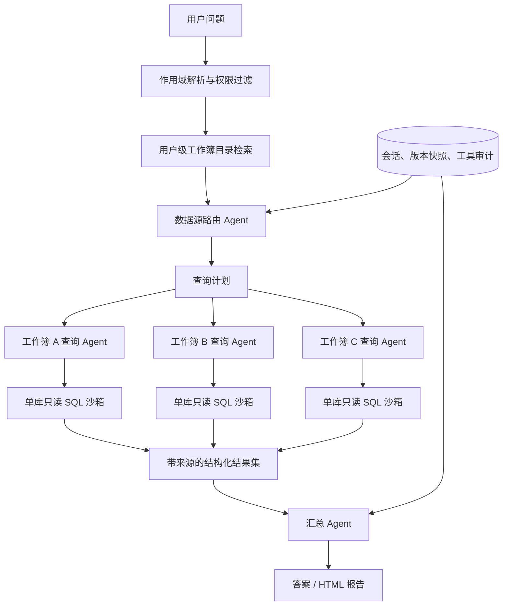

# 多工作簿 Agent 升级实施计划

## 1. 背景与目标

当前 Excel Workbook Service 已具备稳定的单工作簿问数链路：

```text
workbook_id
→ 当前激活版本 database.sqlite
→ manifest + 样本上下文
→ Agent 生成 SQL
→ SQLGlot / 只读连接 / SQLite Authorizer
→ 查询结果与报告
```

现有隔离方式必须保留：每个工作簿继续使用独立、版本化的 SQLite；现有
`POST /workbooks/{workbook_id}/ask` 继续只查询该工作簿，不改变其权限、SQL
沙箱和会话语义。

本次升级的目标是在此基础上新增“多工作簿 Agent”：用户可以在自己有权访问
的数据范围内提问，Agent 自动发现相关工作簿、逐库查询，并将结果汇总为带明确
数据来源的答案或报告。

## 当前执行状态

已完成全部 phase 的首个可运行版本：

- owner-scoped `workbook_catalog` 元数据表与 manifest 摘要构建；
- 导入确认、版本激活、工作簿删除时的目录生命周期处理；
- 旧安装的 active 工作簿目录惰性回填；
- 服务端生成的 active database 版本快照；
- `GET /api/v1/data-catalog`；
- `POST /api/v1/agent/ask` 自动/指定工作簿作用域；
- 多工作簿 Agent 的 `search_workbooks`、`inspect_workbook`、
  `query_workbook`、`terminate` 工具；
- 每库独立只读 SQL、来源标注、最大选库/查询数和跨 owner 防护；
- 全局 Agent 会话、数据空间、显式跨库关系和来源快照；
- owner-filtered FTS5 目录召回（无 FTS5 时自动退回关键词评分）；
- 单/多工作簿统一 Agent 路由、受控结果汇总器、部分失败语义；
- 前端“智能问数”入口、范围选择、会话选择、来源/版本/失败状态展示；
- 配置灰度开关、目录回填脚本和评测清单；
- 79 项回归测试全部通过。

embedding、复杂关系 JOIN 和独立 synthesis 模型仍保留为后续增强项；当前版本不允许
模型绕过已确认关系直接执行跨库 JOIN，满足隔离优先的验收边界。

目标包括：

- 保留单工作簿严格隔离模式和现有 API 兼容性；
- 所有问数与分析统一走 Agent 模型，不再依赖规则模板生成最终答案或报告；
- 支持“当前工作簿”“指定集合”“自动从我的数据中选取”三种作用域；
- 支持一个问题查询多个工作簿，但每次 SQL 仍在单个 SQLite 内独立执行；
- 每个结论可追溯到工作簿、版本、表、SQL 和结果；
- 权限判断、SQL 安全、资源预算继续由确定性代码执行，不能交给模型决定；
- 为后续显式跨库关联、统一指标和业务语义层预留扩展点。

## 2. 非目标

第一阶段不做以下事项：

- 不把所有 SQLite 合并成一个共享数据库；
- 不允许模型直接提供数据库路径或执行 SQLite `ATTACH`；
- 不让模型根据同名字段自行认定跨工作簿 JOIN 关系；
- 不对无权限工作簿建立可被当前用户检索的目录上下文；
- 不用向量相似度替代 SQL 查询结果；
- 不在第一阶段做任意行级跨库 JOIN；
- 不移除 SQLGlot、只读连接、Authorizer、超时和行数限制。

## 3. 必须保持的隔离边界

### 3.1 数据隔离

- 一个 `workbook_id` 对应一个逻辑数据集；
- 每个导入版本继续拥有独立 `database.sqlite`；
- Agent 工具只接受服务端解析后的 `workbook_id`，不接受客户端数据库路径；
- 每条 SQL 只在一个已授权工作簿的已固定版本上执行；
- 多工作簿答案来自多个独立查询结果的汇总，不通过直接连接数据库文件实现；
- 工作簿删除、版本切换、报告和血缘仍按 `workbook_id` 管理。

### 3.2 权限隔离

- 数据源候选列表必须先按 `owner_id` 过滤，再进入目录检索或模型上下文；
- 客户端传入的每个 `workbook_id` 都必须重新校验所有权；
- Agent 选出的工作簿必须属于本轮服务端生成的允许集合；
- 对不存在和无权限的数据源统一返回不可见，避免枚举；
- 会话恢复时重新校验会话作用域内全部工作簿；
- 数据目录缓存以 `owner_id + active_import_id` 为边界，禁止跨用户复用未过滤结果。

### 3.3 版本隔离

每轮开始时生成不可变的数据源快照：

```json
{
  "workbook_id": "...",
  "import_id": "...",
  "version": 3,
  "schema_digest": "..."
}
```

本轮所有查询都使用该快照。即使问数过程中用户切换了激活版本，也不能让同一轮
前后查询落到不同版本。下一轮可重新解析最新激活版本，并在会话中记录版本变化。

## 4. 产品模式

### 4.1 当前工作簿模式

继续使用现有入口：

```http
POST /api/v1/workbooks/{workbook_id}/ask
```

特点：

- 只允许访问路径中的工作簿；
- 保持现有会话和前端交互；
- 默认模式，行为与当前版本兼容；
- 内部改为统一使用新的 Agent 编排器，但工具作用域只有一个工作簿。

### 4.2 指定数据集合模式

用户创建“数据空间”，显式选择一组工作簿，例如“采购数据”“项目台账”。Agent
只能从该集合中选择数据源。

适合稳定、可复用的业务分析范围，也便于配置跨工作簿字段关系。

### 4.3 自动选库模式

Agent 在当前用户所有已激活工作簿的目录摘要中检索候选，再选择与问题相关的少量
工作簿。模型不能看到无权限目录，也不能突破服务端候选上限。

推荐默认最多：

- 目录初筛 20 个工作簿；
- 模型选择 5 个工作簿；
- 单轮实际查询 3 个工作簿；
- 超出时要求用户缩小范围，或分批执行并明确提示。

## 5. 目标架构



编排分为三个阶段：

1. **发现**：从已授权目录中找到可能相关的工作簿；
2. **执行**：对每个工作簿独立生成和执行 SQL；
3. **汇总**：只基于已执行结果生成答案，并保留证据来源。

## 6. 数据目录设计

### 6.1 目录内容

新增 `workbook_catalog`，每个激活工作簿一条目录记录。建议字段：

| 字段 | 用途 |
| --- | --- |
| `workbook_id` | 工作簿标识 |
| `owner_id` | 权限过滤 |
| `active_import_id` | 当前目录对应的导入版本 |
| `active_version` | 可读版本号 |
| `display_name` | 用户可读名称 |
| `source_file` | 来源文件名 |
| `schema_digest` | schema 变化检测 |
| `catalog_text` | 用于 FTS 检索的受限文本 |
| `catalog_json` | 表、字段、类型、行数和语义摘要 |
| `status` | `ready / stale / failed` |
| `gmt_modified` | 更新时间 |

`catalog_json` 建议格式：

```json
{
  "workbook_id": "wb-1",
  "display_name": "2025年采购目录汇总",
  "version": 1,
  "tables": [
    {
      "table_name": "purchase_items",
      "display_name": "采购明细",
      "row_count": 1200,
      "columns": [
        {
          "physical_name": "material_code",
          "display_name": "物料编码",
          "sql_type": "TEXT",
          "semantic_type": "identifier"
        }
      ]
    }
  ],
  "keywords": ["采购", "物料", "供应商"]
}
```

路由阶段默认不提供原始行样本，以减少隐私暴露和提示词长度。只有工作簿被选中并
再次通过权限校验后，查询 Agent 才读取该库的 manifest 和受限样本。

### 6.2 目录生成时机

- `confirm_import()` 成功并激活新版本后生成或更新目录；
- `activate_version()` 切换版本后更新目录；
- 工作簿删除时同步删除目录记录与集合成员关系；
- 服务升级时提供一次性回填脚本，从现有 active SQLite 重建目录；
- 目录生成失败不影响单工作簿问数，但自动选库时不使用失败记录；
- `schema_digest` 与 `active_import_id` 不一致时标记为 stale，并惰性重建。

### 6.3 候选召回

第一版使用 SQLite FTS5 或受控关键词评分搜索 `display_name`、Sheet 显示名和字段
显示名，再由 Agent 从候选摘要中选择。目录召回是检索机制，不负责生成最终分析
结论，因此不属于效果较差的规则模板问数路线。

后续可增加 embedding 作为目录召回信号，但必须满足：

- 只向量化 schema/目录摘要，不默认向量化全部业务行；
- 向量索引包含 `owner_id` 和版本过滤；
- embedding 只负责找候选数据源，事实仍由 SQL 返回。

## 7. 数据空间与关系模型

### 7.1 数据空间

新增：

```text
data_space
- space_id
- owner_id
- name
- description
- gmt_created / gmt_modified

data_space_workbook
- space_id
- workbook_id
- alias
- enabled
```

数据空间只保存引用，不复制业务数据。成员工作簿仍保留独立权限和版本。

### 7.2 显式跨库关系

后续新增 `dataset_relation`：

```text
- relation_id
- owner_id
- left_workbook_id / left_table / left_column
- right_workbook_id / right_table / right_column
- relation_type
- cardinality
- enabled
- confirmed_by
```

关系必须来自用户确认、导入配置或可审计规则，不能仅凭模型猜测。未定义关系时，
Agent 可以分别统计并比较多个工作簿，但不得声称完成了可靠的行级 JOIN。

## 8. 会话模型升级

现有 `workbook_conversation` 绑定单一 `workbook_id`。建议兼容扩展：

- `scope_type`: `workbook / space / auto`；
- `scope_json`: 固定工作簿、数据空间或候选限制；
- `source_snapshot_json`: 每轮实际使用的数据源版本快照；
- 单工作簿旧记录自动视为 `scope_type=workbook`；
- 会话消息的工具元数据增加 `workbook_id/import_id/version`；
- 前端恢复会话时显示本轮使用的数据源与版本。

若 SQLite 迁移中将 `workbook_id` 改为 nullable 风险较高，可先新增独立的
`agent_conversation` / `agent_message` 表；单工作簿接口通过适配层使用统一会话服务。
推荐先扩展现有表，避免长期维护两套消息协议，但必须提供可回滚的数据迁移测试。

## 9. 新 API 设计

保留所有现有工作簿 API，新增全局入口：

```http
POST /api/v1/agent/ask
Content-Type: application/json

{
  "question": "比较今年各采购目录的供应商和采购数量",
  "scope": {
    "mode": "auto"
  },
  "conv_id": null,
  "model": "agent-model",
  "max_rows": 500
}
```

指定工作簿：

```json
{
  "scope": {
    "mode": "selected",
    "workbook_ids": ["wb-1", "wb-2"]
  }
}
```

指定数据空间：

```json
{
  "scope": {
    "mode": "space",
    "space_id": "space-1"
  }
}
```

配套 API：

```text
GET    /api/v1/data-catalog/search?q=...
GET    /api/v1/data-spaces
POST   /api/v1/data-spaces
PATCH  /api/v1/data-spaces/{space_id}
DELETE /api/v1/data-spaces/{space_id}
GET    /api/v1/agent/conversations
GET    /api/v1/agent/conversations/{conv_id}
DELETE /api/v1/agent/conversations/{conv_id}
```

目录搜索响应只返回当前用户有权访问的摘要。

## 10. Agent 工具协议

统一 Agent 建议提供以下工具：

### `search_workbooks`

输入问题关键词，返回服务端权限过滤后的候选目录。模型不能指定 `owner_id`。

### `inspect_workbook`

读取一个候选工作簿的 manifest、字段映射和受限样本。调用前再次验证该工作簿属于
本轮允许集合。

### `query_workbook`

```json
{
  "workbook_id": "wb-1",
  "sql": "SELECT ..."
}
```

内部继续调用现有 `execute_readonly_sql()`，并返回：

```json
{
  "source": {
    "workbook_id": "wb-1",
    "display_name": "采购目录",
    "import_id": "import-3",
    "version": 3
  },
  "sql": "SELECT ...",
  "columns": [],
  "rows": [],
  "row_count": 0,
  "truncated": false
}
```

### `render_report`

根据已有查询结果生成报告。报告中的数字必须能映射到一个或多个工具结果，来源脚注
至少包含工作簿名称、版本和查询标识。

### `terminate`

返回最终答案，并附实际使用的数据源列表。模型不能在没有查询证据时生成业务数字。

## 11. 多工作簿执行策略

### 11.1 查询计划

路由 Agent 先生成结构化计划：

```json
{
  "intent": "compare",
  "sources": [
    {"workbook_id": "wb-1", "reason": "包含2025采购明细"},
    {"workbook_id": "wb-2", "reason": "包含2024采购明细"}
  ],
  "operations": [
    {"source": "wb-1", "goal": "按供应商汇总数量"},
    {"source": "wb-2", "goal": "按供应商汇总数量"}
  ],
  "merge": "compare_by_supplier"
}
```

服务端校验计划中的数据源、数量上限与作用域后，再执行查询。

### 11.2 结果汇总

第一阶段支持：

- 多工作簿独立事实汇总；
- 相同维度聚合结果的对比；
- 相同 schema 的结果集合并；
- 按工作簿分组的趋势、排名和差异说明；
- 带来源的 HTML 报告。

第一阶段不支持无关系声明的明细行 JOIN。若结果需要合并，先要求每个子查询返回统一
别名和聚合粒度，再由受控合并器处理；不得把无限量明细全部塞回模型。

### 11.3 并发

不同工作簿的独立查询可以限量并行，建议默认最大并发 3。每个查询仍占用 SQL 并发槽，
整轮同时受全局 Agent 预算约束。任何子查询失败都要作为带来源的错误返回，不能静默
丢弃后继续给出完整性结论。

## 12. 安全与预算

新增多库预算：

```text
max_catalog_candidates
max_selected_workbooks
max_queried_workbooks
max_sql_calls_per_workbook
max_total_sql_calls
max_rows_per_source
max_total_result_cells
max_source_context_chars
max_aggregate_context_chars
max_seconds
```

继续沿用：

- SQLGlot 单条 SELECT/WITH 校验；
- SQLite `mode=ro`；
- SQLite Authorizer；
- SQL 超时、VM 步数、行数限制；
- Agent LLM/tool/token/时间预算；
- 工作簿内容与 SQL 结果的 untrusted-data 包装；
- HTML 清洗、报告路径校验和所有权校验。

新增防线：

- 工具参数中的 `workbook_id` 必须属于本轮 server-side allowlist；
- 数据源路由结果必须经过代码校验，不直接执行模型输出；
- 最终答案中引用的 source ID 必须存在于本轮工具结果；
- 日志不得输出完整业务样本；
- 单个工作簿失败时将答案标记为“部分结果”，列出缺失来源；
- 自动模式不得返回用户无权限工作簿的名称、数量或存在性。

## 13. SSE 与前端体验

新增 SSE 事件：

```text
scope.resolved       # 本轮作用域
catalog.candidates   # 候选数据源摘要
source.selected      # Agent 选择的数据源及原因
source.inspect       # 某工作簿 schema 已读取
source.query.start   # 子查询开始
source.query.result  # 带来源结果
source.query.error   # 单源失败
synthesis.start      # 开始汇总
done                 # 最终答案与 sources
```

前端增加“智能问数”入口，并保留工作簿内现有问数页面：

- 作用域选择：当前工作簿 / 数据空间 / 自动选择；
- 数据源候选与最终选中来源可展开查看；
- 每个 SQL/结果卡片标明工作簿、版本和表；
- 答案底部显示“本次使用的数据源”；
- 部分失败时显示醒目但不中断其他来源；
- 会话切换时恢复当时的数据源快照，不用当前目录覆盖历史证据；
- 用户可在发送前锁定或排除工作簿。

## 14. 全 Agent 路由调整

目标状态下，问数不再按模型大小选择规则模板：

- 单工作簿和多工作簿都使用 Agent ReAct/工具调用链；
- `analysis_route` 对问数固定为 `agent`，保留旧 `small/large` 字段兼容读取；
- `app/analysis/profile.py` 可继续作为目录和质量信号生成器；
- `templates.py`、固定报告可保留为可选工具或回归基准，但不再作为默认问答路线；
- Agent 模型不可用时返回明确错误，不以规则模板生成一个看似完整但质量不足的答案；
- 配置增加默认 Agent 模型和多工作簿专用模型覆盖项。

注意：去掉规则模板只改变“谁负责理解与生成答案”，不会移除确定性安全校验和数据边界。

## 15. 代码落点建议

```text
app/
├── agent/
│   ├── multi_workbook_loop.py      # 多工作簿编排循环
│   ├── source_router.py            # 候选选择与计划校验
│   ├── source_tools.py             # search/inspect/query 工具
│   ├── synthesis.py                # 结果汇总与来源约束
│   └── multi_workbook_prompt.py    # 多数据源提示词
├── catalog/
│   ├── builder.py                  # 从 manifest/profile 构建目录
│   ├── search.py                   # FTS/关键词候选召回
│   └── models.py                   # 目录 DTO
├── models/
│   ├── catalog.py                  # 目录、空间、关系表
│   └── conversation.py             # 会话作用域扩展
├── service/
│   ├── multi_workbook.py           # 权限、快照、并发与预算
│   └── service.py                  # confirm/activate/delete 目录钩子
└── api/
    └── endpoints.py                # 新全局 Agent/数据空间 API
```

前端第一版仍可在 `examples/frontend/index.html` 增加独立“智能问数”视图；与正式 Vue3
前端对接时复用同一 API 和 SSE 协议。

## 16. 分阶段实施

### Phase 0：统一 Agent 路线与基线

- [x] 将默认问数路由切换为 Agent；
- [x] 保留旧参数兼容，但不再默认进入规则模板；
- [x] 补齐单工作簿 Agent 回归集和效果基线；
- [x] 固化现有 SQL、安全、会话、SSE 测试；
- [x] 记录当前延迟、SQL 成功率和回答可追溯率。

验收：现有单工作簿 API、会话和报告行为不回退，安全测试全部通过。

### Phase 1：工作簿目录

- [x] 新增 `workbook_catalog` 模型与 DAO；
- [x] 实现 catalog builder 和 `schema_digest`；
- [x] 接入 confirm/activate/delete 生命周期；
- [x] 提供现有数据回填脚本；
- [x] 实现 owner-scoped 目录搜索 API；
- [x] 增加 stale/failed 重建机制。

验收：目录与 active version 一致；任何目录查询都不能跨 owner 泄露。

### Phase 2：多工作簿只读编排 MVP

- [x] 新增 `/agent/ask` SSE API；
- [x] 实现作用域解析、权限 allowlist 和版本快照；
- [x] 实现 `search_workbooks`、`inspect_workbook`、`query_workbook`；
- [x] 实现服务端作用域/工具参数校验；
- [x] 实现逐库查询和带来源结果；
- [x] 实现基于已执行结果的受控汇总器；
- [x] 加入多库总预算与部分失败语义。

验收：一个问题能自动选中 2～3 个相关工作簿并给出可核验答案，且每个数字有来源。

### Phase 3：数据空间与前端

- [x] 新增 data space 与成员关系；
- [x] 扩展会话 scope 和 source snapshot；
- [x] 增加智能问数全局页面；
- [x] 展示选库事件、SQL、版本、结果和失败来源；
- [x] 支持用户锁定数据源；
- [x] 支持多工作簿答案与受控汇总结果。

验收：用户能明确控制数据范围；刷新和多轮会话不会丢失或串用数据源。

### Phase 4：显式跨库关系与受控合并

- [x] 新增 `dataset_relation`；
- [x] 提供关系审核 API；
- [x] 实现相同/相近 schema 的受控 UNION 合并器；
- [x] 实现聚合结果的维度对齐；
- [x] 明确禁止未确认关系的跨库 JOIN；
- [x] 查询和汇总结果保留来源血缘。

验收：只有已确认关系能执行跨库行级关联；错误或模糊关系不会被模型自动采用。

### Phase 5：评测、灰度与优化

- [x] 建立单库/多库/错误选库/权限攻击评测清单；
- [x] 定义选库、SQL、事实、延迟和成本指标；
- [x] 使用 feature flag 灰度开启；
- [x] 对目录做 active_import/version 失效和 FTS 加速；
- [x] 保留 embedding 作为后续可选召回增强；
- [x] 完成旧规则模板默认路由下线。

## 17. 测试计划

### 单元测试

- 目录构建与 manifest 字段映射；
- 目录按 owner 过滤；
- 作用域与 allowlist 校验；
- 版本快照固定；
- 路由计划 JSON 校验；
- 多库预算计数；
- 来源引用校验；
- 部分失败状态；
- 会话 scope 迁移与恢复。

### 集成测试

- 两个同 owner 工作簿的自动选库和对比；
- 不同 owner 的工作簿绝不进入候选；
- selected scope 中混入无权限 ID 时整体拒绝；
- 查询期间切换 active version，当前轮仍使用原快照；
- 一个工作簿超时，其他工作簿结果仍返回并标记部分完成；
- 恶意单元格内容不能影响路由 Agent 或 SQL Agent；
- 多工作簿报告中的每个数值可映射到查询结果；
- 原 `/workbooks/{workbook_id}/ask` 仍不能访问其他工作簿。

### 端到端测试

- 自动模式提问、选库、SQL、汇总、刷新恢复；
- 数据空间创建、成员修改和会话问数；
- 用户排除错误候选后重新执行；
- 删除工作簿后目录、空间成员和会话展示一致；
- 浏览器断流重连不重复持久化答案和工具记录。

## 18. 验收指标

功能指标：

- 单工作簿隔离回归测试 100% 通过；
- 无权限数据源召回率必须为 0；
- 自动选库 Top-5 Recall 在评测集达到 95% 以上；
- 最终答案中的数值来源覆盖率为 100%；
- 多库部分失败时不得输出“全部数据已统计”等完整性断言；
- 历史会话能恢复当轮工作簿与版本快照。

性能建议值：

- 目录检索 P95 小于 300 ms；
- 自动选库与计划生成 P95 小于 5 s（不含模型拥塞）；
- 默认最多查询 3 个工作簿；
- 单轮上下文不超过配置预算；
- 单轮总时长继续受 Agent `max_seconds` 限制。

## 19. 风险与应对

| 风险 | 应对 |
| --- | --- |
| Agent 选错工作簿 | 展示候选和原因；支持锁定/排除；建立选库评测集 |
| 提示词随数据源数量膨胀 | 先检索摘要，再按需 inspect；限制候选和总字符数 |
| 跨库比较口径不一致 | 显示字段映射与版本；只合并同粒度聚合结果 |
| 模型猜测 JOIN | 默认禁止；只允许显式 `dataset_relation` |
| 版本切换导致前后不一致 | 每轮固定 active import 快照 |
| 一个大库拖慢整轮 | 分库预算、并发上限、部分失败语义 |
| 权限目录泄露 | owner 过滤先于检索；模型只看到过滤后摘要 |
| 多 Agent 成本增加 | 限制选库数；复用 schema 缓存；先路由再展开上下文 |

## 20. 推荐的首个可交付版本

首个版本只实现最有价值且风险可控的闭环：

```text
全局提问
→ owner 过滤后的目录检索
→ Agent 选择最多 3 个工作簿
→ 每库独立 inspect + SQL
→ 汇总查询结果
→ 返回答案与来源
```

暂不做行级跨库 JOIN、embedding 和复杂关系推断。这样可以在完全保留现有 SQLite
隔离与安全沙箱的前提下，先验证自动选库和多源汇总的真实效果，再逐步加入数据空间、
显式关系和高级分析能力。
